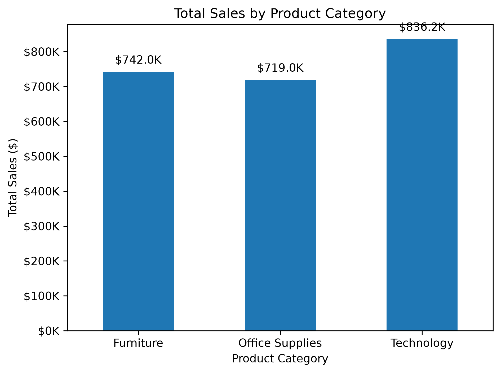
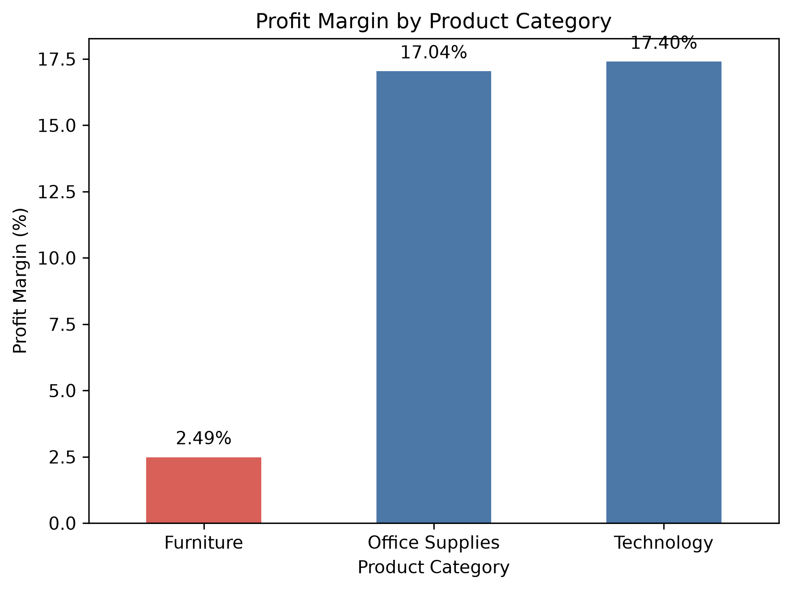
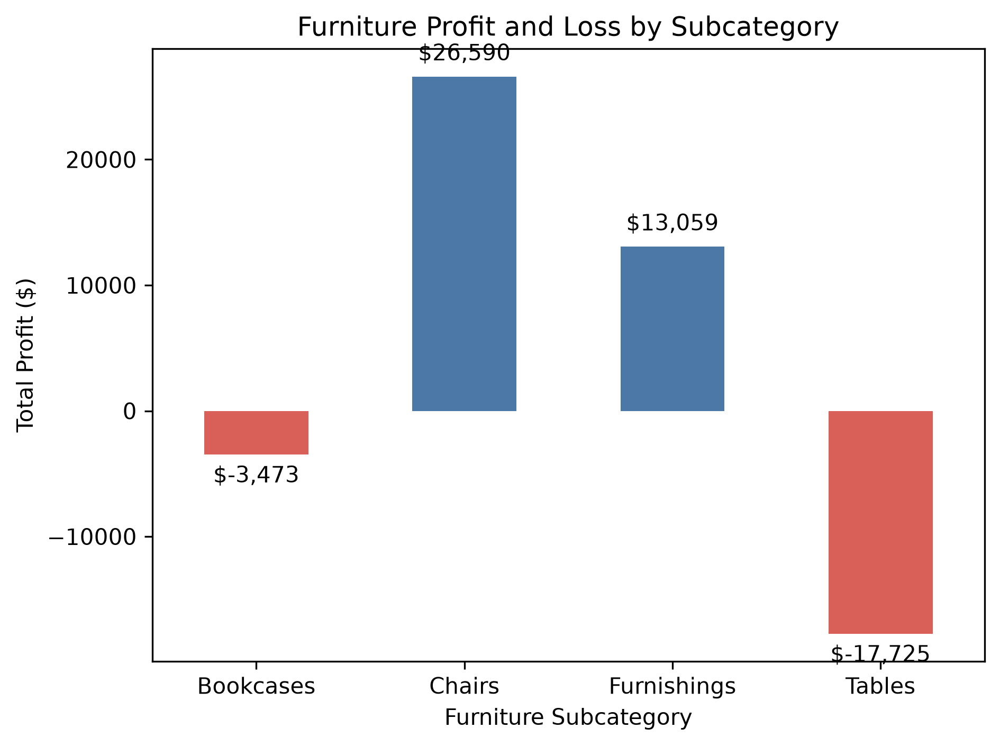
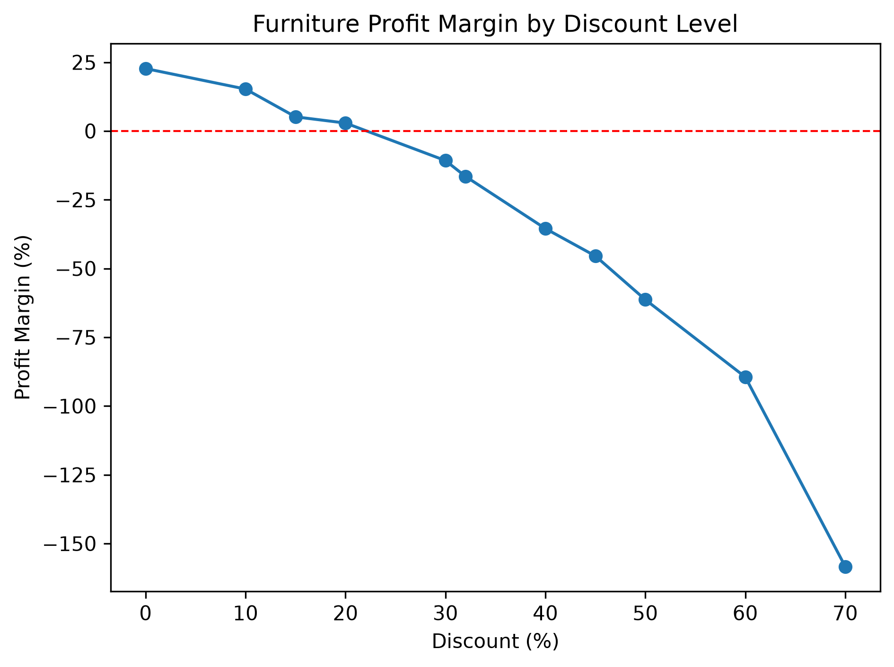

# Retail Sales & Profitability Analytics

## Project Overview
An end-to-end data analytics project focused on understanding retail sales performance, profitability, and business trends.

## Business Objectives
- Analyze sales and revenue trends.
- Identify high-performing products and categories.
- Evaluate profitability across different segments.
- Discover opportunities to improve business performance.

## Tools and Technologies
- SQL
- Python (pandas, matplotlib)
- Power BI or an alternative dashboard tool
- Git and GitHub

## Project Status
In progress — initial project setup.

## Planned Deliverables
- SQL analysis queries
- Python data analysis notebook
- Interactive sales dashboard
- Business insights and recommendations

## Key Findings

### 1. Furniture Profitability and Discounts

The Superstore dataset contains 9,994 order-line records, with approximately $2.30 million in total sales and $286,397 in recorded profit, resulting in an overall profit margin of 12.47%.

Furniture generated approximately $742,000 in sales but achieved a profit margin of only 2.49%, compared with 17.04% for Office Supplies and 17.40% for Technology.

Further analysis identified Tables as the largest loss-making Furniture subcategory, with a total loss of approximately $17,725.

An analysis of Furniture discounts found that every observed discount group at 30% or higher had a negative aggregate profit margin, whereas all groups at 20% or lower remained profitable. Some higher-discount groups contained relatively few records, so their individual margins should be interpreted cautiously.

**Business implication:** Review discount policies for loss-making Furniture products, particularly Tables, and investigate product costs and pricing before making changes. The observed relationship does not establish that discounting alone caused the losses.

## Data Visualizations

### 1. Total Sales by Category

### 2. Profit Margin by Category

### 3. Furniture Subcategory Profit and Loss

### 4. Furniture Discount vs. Profit Margin
